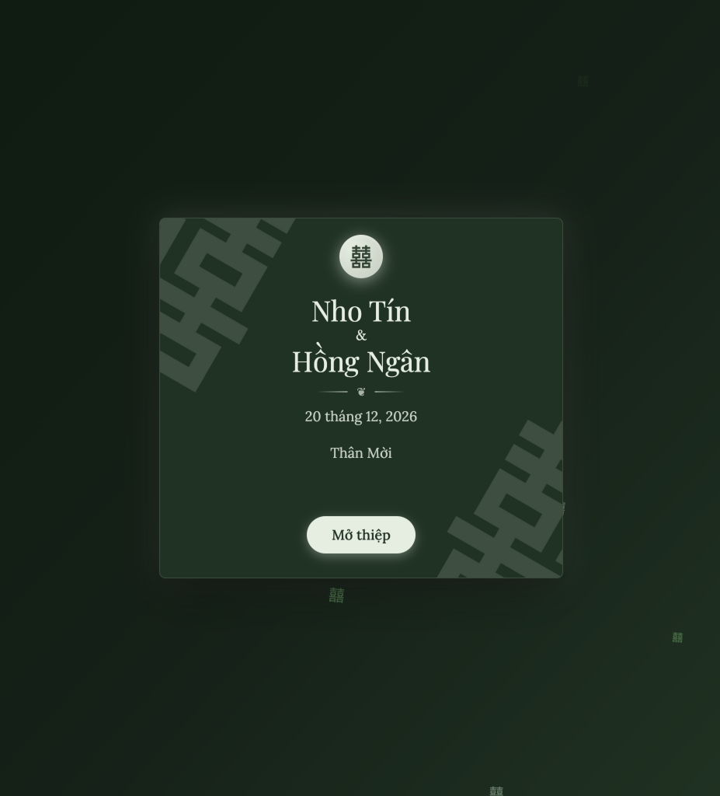
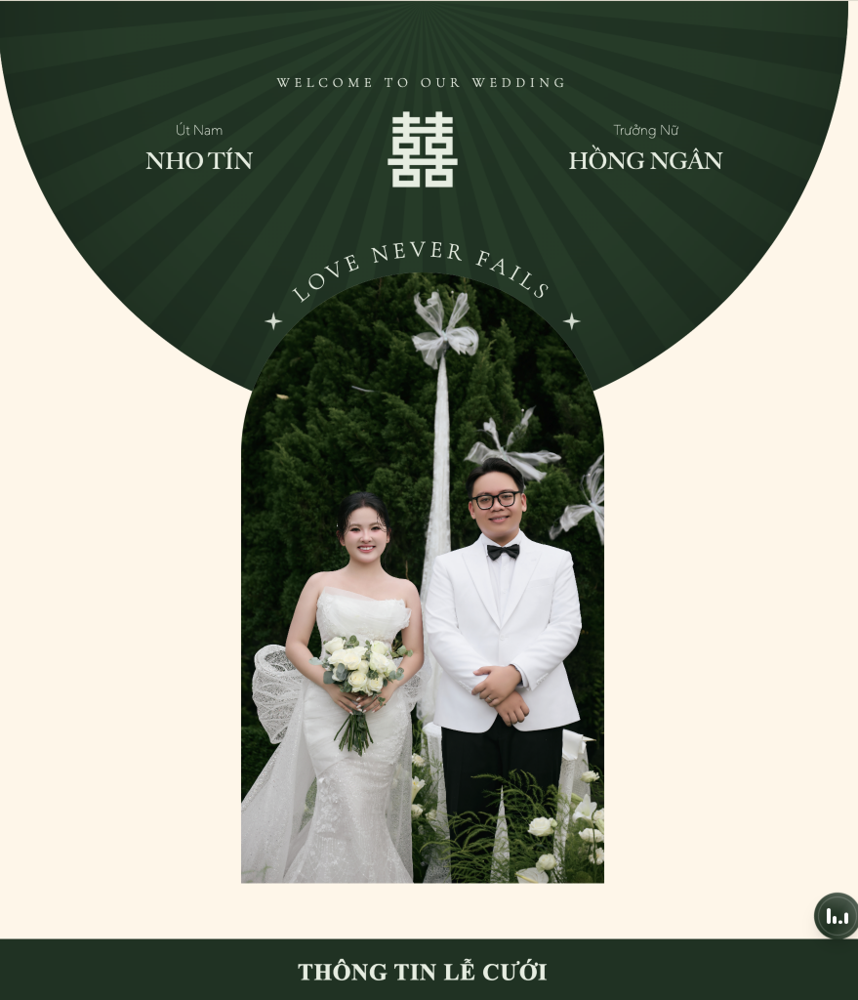
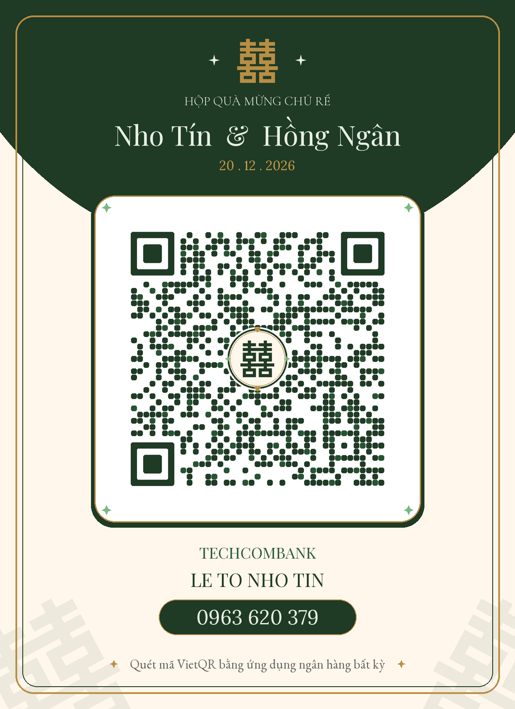
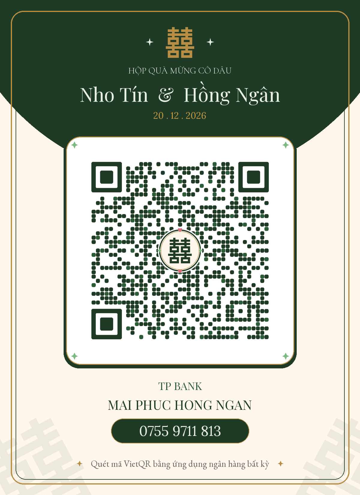

# Thiệp Cưới Online Song Hỷ Xanh - Nho Tín & Hồng Ngân

Website thiệp cưới trực tuyến phong cách Song Hỷ Xanh dành cho Lễ Thành Hôn của **Lê Tô Nho Tín** và **Mai Phúc Hồng Ngân** (Chủ Nhật, ngày 20 tháng 12 năm 2026). Dự án bao gồm giao diện thiệp cưới tương tác và hệ thống Backend API lưu trữ trực tiếp lời chúc cùng xác nhận tham dự của khách mời ra file JSON.

---

## Hình Ảnh Giao Diện

### 1. Bìa Thiệp Mời và Con Dấu Sáp Song Hỷ



### 2. Giao Diện Chính Thiệp Cưới



### 3. Thiệp QR Mừng Cưới Chú Rể và Cô Dâu

| QR Mừng Cưới Chú Rể | QR Mừng Cưới Cô Dâu |
| :---: | :---: |
|  |  |

---

## Thông Tin Lễ Cưới

- **Chú Rể**: Lê Tô Nho Tín (Út Nam)
- **Cô Dâu**: Mai Phúc Hồng Ngân (Trưởng Nữ)
- **Nhà Trai**: Ông Lê Nho Lượng & Bà Tô Nguyễn Anh Thi (178/24 Huỳnh Văn Luỹ, KP. Phú Hữu, P. Phú Lợi, TP. Hồ Chí Minh)
- **Nhà Gái**: Ông Mai Xuân Đông & Bà Lê Thị Thu (Thôn Phong An, Xã Phù Cát, Tỉnh Gia Lai)
- **Lễ Thành Hôn**: 08:05 - Chủ Nhật, ngày 20 tháng 12 năm 2026 (tức ngày 12 tháng 11 năm Bính Ngọ)
- **Tiệc Cưới**: Đón khách 10:30, Khai tiệc 11:30 cùng ngày
- **Địa Điểm**: Tư Gia - B9 - Ô 07, Đường Ven Sông Thị Tính, Khu Mega City Cầu Đò 2, P. Long Nguyên, TP. Hồ Chí Minh

---

## Tính Năng Chính

1. **Bìa Thiệp và Hiệu Ứng Mở Thiệp**:
   - Con dấu sáp tròn in chữ Song Hỷ có hiệu ứng nhịp thở.
   - Hai họa tiết Song Hỷ chìm ở góc trên-trái và dưới-phải của bìa thiệp.
   - Hiệu ứng hạt Song Hỷ trôi nền được tối ưu tăng tốc GPU (`translate3d`).
   - Khi nhấn **Mở thiệp** hoặc nhấn vào con dấu sáp: âm thanh chuông ngân (Web Audio API), con dấu sáp vỡ ra, hai chữ Song Hỷ ở góc phóng bay về phía trước, hạt Song Hỷ bung tỏa và bìa thiệp trượt lên.
   - Hỗ trợ cá nhân hóa tên khách mời qua tham số URL `?guest=Tên+Khách+Mời` và mở thẳng thiệp qua `?open=1`.

2. **Trình Phát Nhạc Nền và Chuyển Bài**:
   - Đĩa nhạc xoay ở góc dưới bên phải màn hình kèm danh sách nhạc cưới lãng mạn (Một Đời, Beautiful In White, I Do, A Thousand Years, Until I Found You, Ngày Đầu Tiên).

3. **Album Ảnh 3D Coverflow và Lightbox**:
   - Hiệu ứng xoay 3D Coverflow tự động chuyển ảnh, hỗ trợ vuốt chạm trên điện thoại và xem ảnh phóng to toàn màn hình kèm thanh thumbnail.

4. **Bộ Đếm Ngược, Lịch Tháng 12/2026 và Bản Đồ**:
   - Đếm ngược thời gian thực đến giờ khai tiệc (`20/12/2026 11:30`).
   - Lịch tháng 12/2026 đánh dấu ngày cưới 20/12 và liên kết thêm sự kiện vào Google Calendar.
   - Bản đồ Google Maps nhúng trực tiếp và nút mở chỉ đường.

5. **Sổ Lưu Bút và Xác Nhận Tham Dự (RSVP) Lưu File JSON**:
   - Khách mời gửi lời chúc hoặc xác nhận tham dự sẽ được Backend ghi trực tiếp vào các file JSON trong thư mục `data/submissions/`.

6. **Hộp Quà Mừng Cưới**:
   - Hộp quà tương tác với hiệu ứng pháo giấy khi di chuột và modal hiển thị mã VietQR của Chú Rể và Cô Dâu kèm nút tải ảnh QR.

---

## Cấu Trúc Thư Mục

```text
wedding-invitation/
├── index.html                           # Giao diện HTML chính của thiệp cưới
├── styles.css                           # Các keyframe animation và quy tắc CSS bổ sung
├── app.js                               # Logic tương tác Frontend và kết nối API
├── server.js                            # Node HTTP server (phục vụ tĩnh + Backend API)
├── vite.config.js                       # Cấu hình Vite dev/preview server tích hợp Backend API
├── package.json                         # Khai báo script và dependencies
├── backend/
│   └── submissions-api.js               # Module xử lý API lưu lời chúc và RSVP ra file JSON
├── assets/
│   ├── chungdoi-1.css                   # Bộ khung utility CSS
│   ├── chungdoi-2.css                   # Bộ khung component CSS
│   ├── fonts/                           # Font chữ Playfair Display, Cormorant Garamond, EB Garamond, Lora
│   ├── preview/                         # Ảnh chụp giao diện hiển thị trong README
│   └── theme/                           # Tài nguyên họa tiết Song Hỷ, Sunburst SVG, Giftbox
├── images/
│   └── themes/                          # Họa tiết Song Hỷ và mask con dấu sáp
└── data/
    ├── wedding-info.json                # Dữ liệu thông tin lễ cưới
    ├── audio/                           # Các file nhạc nền MP3
    ├── images/                          # Ảnh cưới Hero, Cover, Album và mã QR ngân hàng
    └── submissions/                     # Thư mục lưu dữ liệu khách mời điền (JSON)
        ├── wishes.json                  # Danh sách lời chúc Sổ lưu bút
        ├── rsvps.json                   # Danh sách và thống kê Xác nhận tham dự (RSVP)
        └── all-submissions.json         # File tổng hợp toàn bộ RSVP và lời chúc
```

---

## Hướng Dẫn Cài Đặt và Chạy Dự Án

### Yêu cầu hệ thống
- Node.js phiên bản 18 trở lên.

### 1. Cài đặt thư viện

```bash
npm install
```

### 2. Chạy môi trường phát triển (Vite Dev Server)

```bash
npm run dev
```

Hoặc chạy bằng Node HTTP Server độc lập:

```bash
npm start
```

Sau khi khởi động, truy cập tại địa chỉ: `http://localhost:3003`

- Xem thiệp với tên khách mời cụ thể: `http://localhost:3003/?guest=Anh+Minh`
- Mở thẳng nội dung thiệp (bỏ qua bìa phong bì): `http://localhost:3003/?open=1`

---

## Hệ Thống Backend và Lưu Trữ File JSON

Mỗi khi khách mời điền form **Sổ Lưu Bút** hoặc **Xác Nhận Tham Dự (RSVP)**, dữ liệu được lưu thành định dạng JSON dễ đọc trong thư mục `data/submissions/`:

1. **`data/submissions/wishes.json`**: Lưu danh sách lời chúc (`id`, `name`, `message`, `time`, `createdAt`).
2. **`data/submissions/rsvps.json`**: Lưu danh sách xác nhận tham dự (`id`, `name`, `attending`, `attendingLabel`, `guests`, `note`, `time`, `createdAt`) và đối tượng `summary` thống kê tổng số phản hồi, số lượt tham dự, số lượt báo bận và tổng số khách tham dự.
3. **`data/submissions/all-submissions.json`**: File tổng hợp chung cả thống kê RSVP, danh sách RSVP và danh sách lời chúc.

### Các API Endpoints

- `GET /api/health` - Kiểm tra trạng thái hoạt động của dịch vụ.
- `GET /api/wishes` - Lấy danh sách lời chúc công khai từ `data/submissions/wishes.json`.
- `POST /api/wishes` - Gửi lời chúc mới (`{ "name": "...", "message": "..." }`), tự động lưu JSON và gửi thông báo Telegram.
- `POST /api/rsvps` - Gửi xác nhận tham dự (`{ "name": "...", "attending": "yes", "guests": 2, "note": "..." }`), tự động lưu JSON và gửi thông báo Telegram khi khách đồng ý tham dự.
- `GET /api/rsvps` *(Bảo vệ — yêu cầu đăng nhập `/admin` hoặc Bearer Token)* - Lấy danh sách và thống kê xác nhận tham dự.
- `GET /api/submissions` *(Bảo vệ — yêu cầu đăng nhập `/admin` hoặc Bearer Token)* - Lấy toàn bộ dữ liệu tổng hợp RSVP và lời chúc.

---

## Trang Quản Trị (`/admin`), Thông Báo Telegram và Bảo Mật Production

1. **Cấu hình biến môi trường (`.env`)**:
   - Sao chép [`.env.example`](.env.example) sang `~/.config/wedding-invitation/.env` (khuyến nghị, đặt quyền `chmod 600`) hoặc `.env` tại thư mục gốc dự án (đã được `.gitignore` loại trừ khỏi Git).
   - Đặt mật khẩu quản trị (lưu dạng băm `scrypt`, không lưu plaintext):
     ```bash
     node scripts/set-admin-password.js
     ```
   - Điền `TELEGRAM_BOT_TOKEN` và `TELEGRAM_CHAT_ID` trong `.env` để nhận thông báo Telegram tức thì khi có khách đồng ý tham dự hoặc gửi lời chúc mới.

2. **Trang quản trị `/admin`**:
   - Truy cập `/admin` để xem thống kê tổng số khách dự kiến, tìm kiếm/lọc danh sách RSVP, đọc sổ lưu bút, xóa mục spam, kiểm tra kết nối Telegram và xuất file CSV/JSON.
   - Phiên đăng nhập sử dụng cookie `HttpOnly` + `SameSite=Strict` (+ `__Host-` & `Secure` trên HTTPS), bảo vệ CSRF và tự khóa IP tạm thời nếu nhập sai mật khẩu quá 5 lần.

3. **Triển khai Production với Nginx + Cloudflare Tunnel**:
   - Máy chủ Node.js lắng nghe nội bộ `127.0.0.1` (`PORT=3008`), áp dụng allowlist tệp tĩnh nghiêm ngặt (chặn truy cập mã nguồn, `.git`, `.env`, `data/submissions/*.json`), CSP chặt chẽ, HSTS, chống XSS và giới hạn tốc độ gửi form.
   - Cấu hình Nginx và script triển khai nằm trong thư mục `deploy/`.
